# Forge of the Eight Stones

A third-person crafting adventure in **Godot 4**. You explore a **round island**,
mine rocks, forge better gear, fight monsters, and defeat the boss of each temple
to win its magic stone.

This is **Chapter 1: The Forge** — a playable slice of the big design document.
Everything below works today.

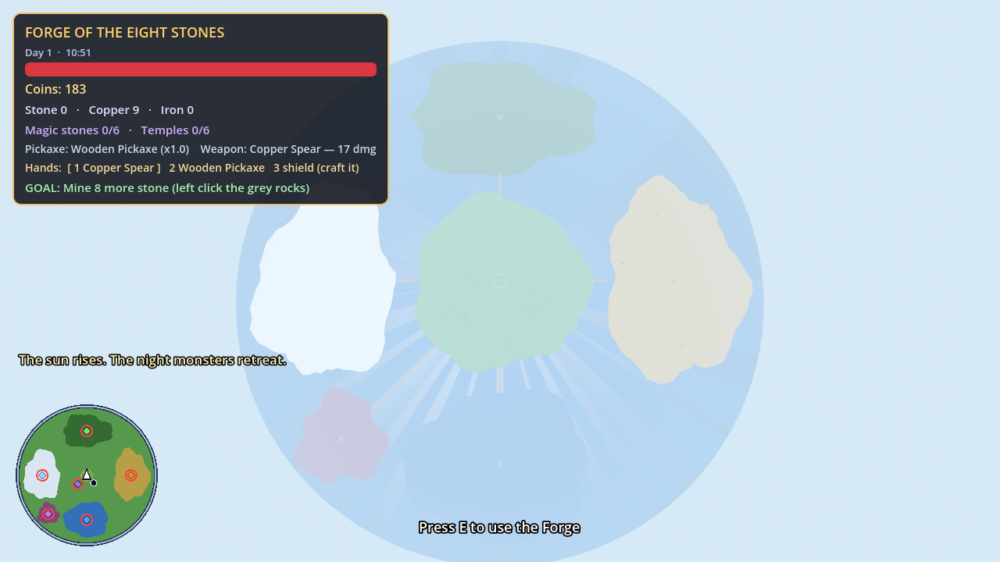

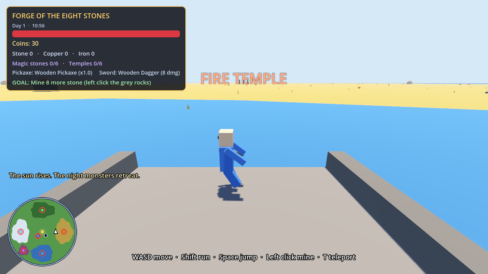

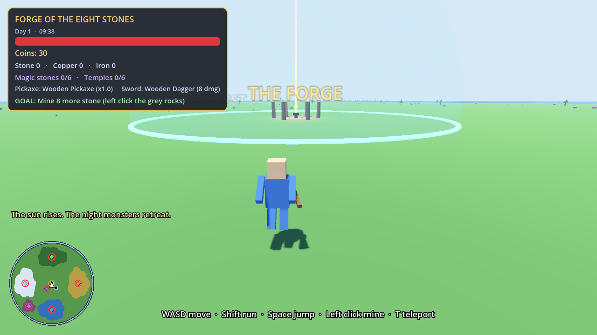

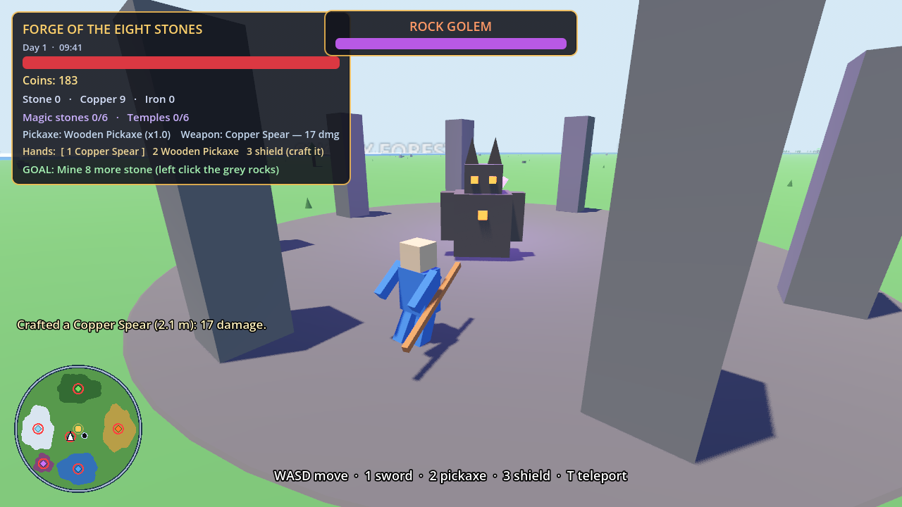

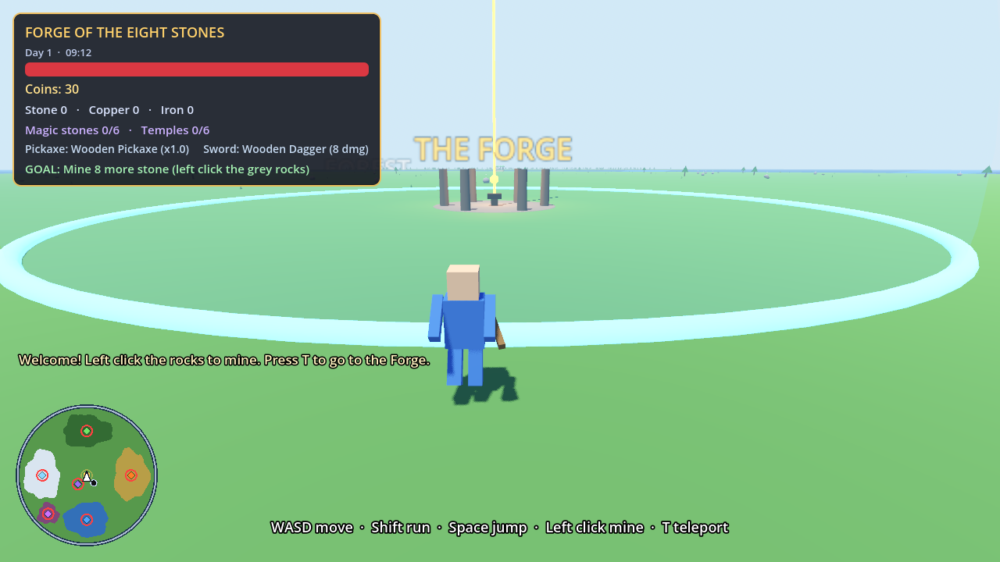

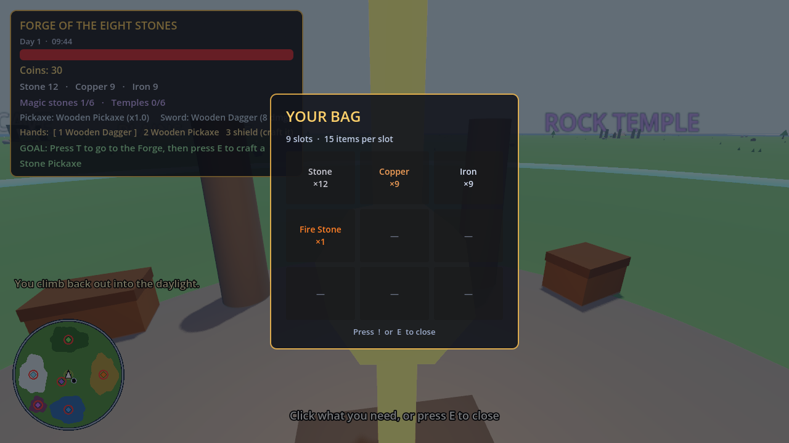

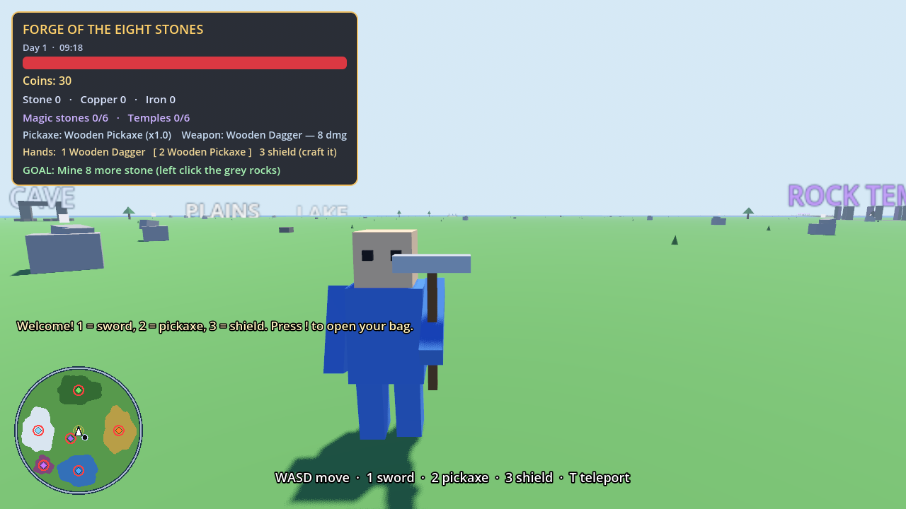

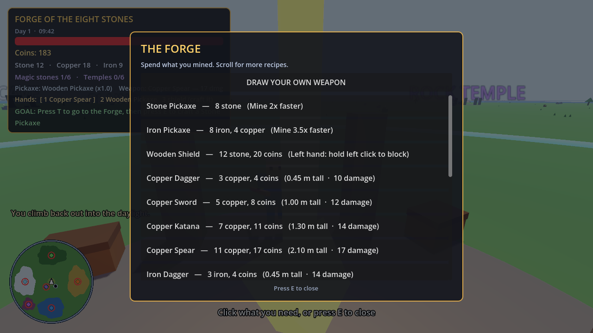

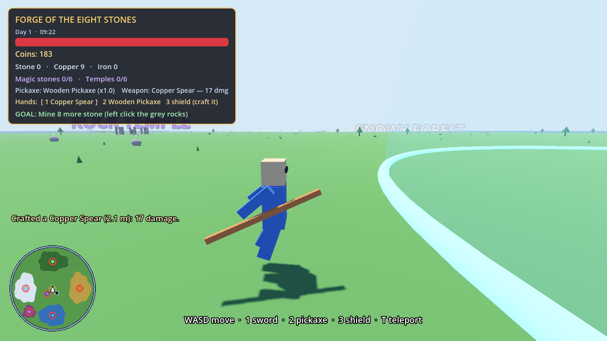

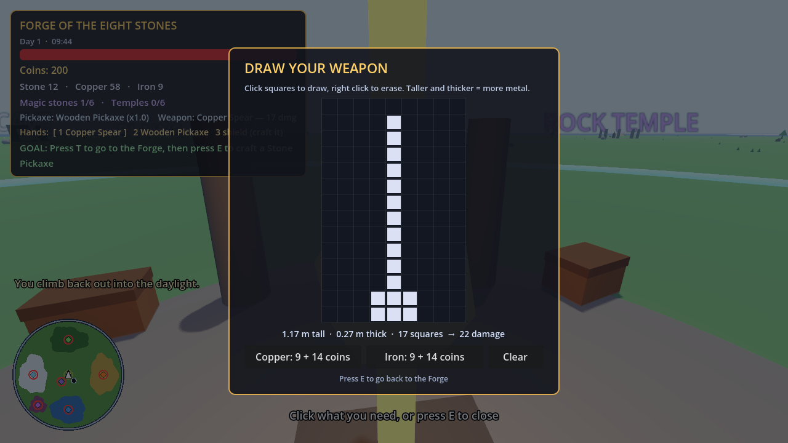

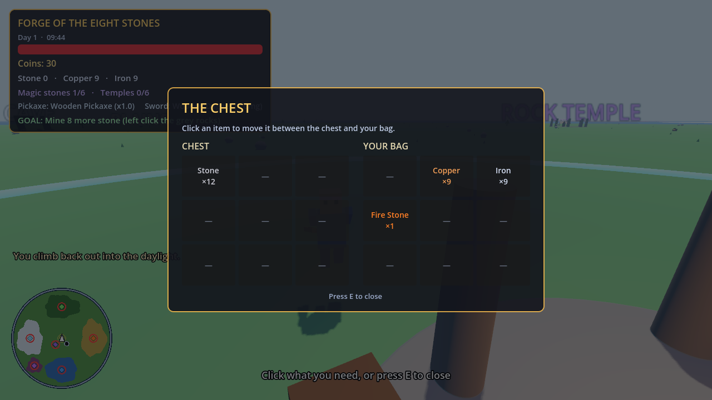

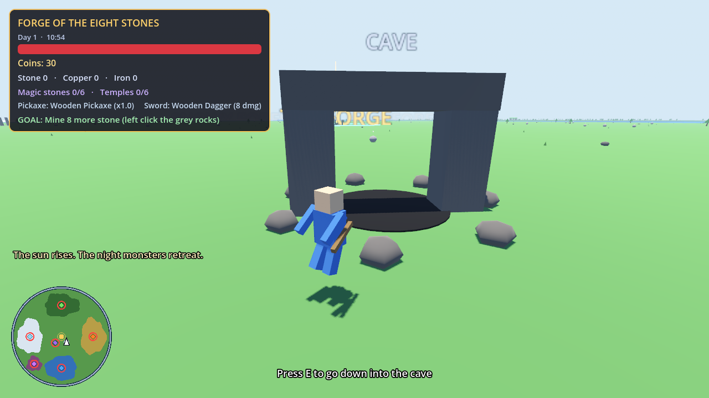

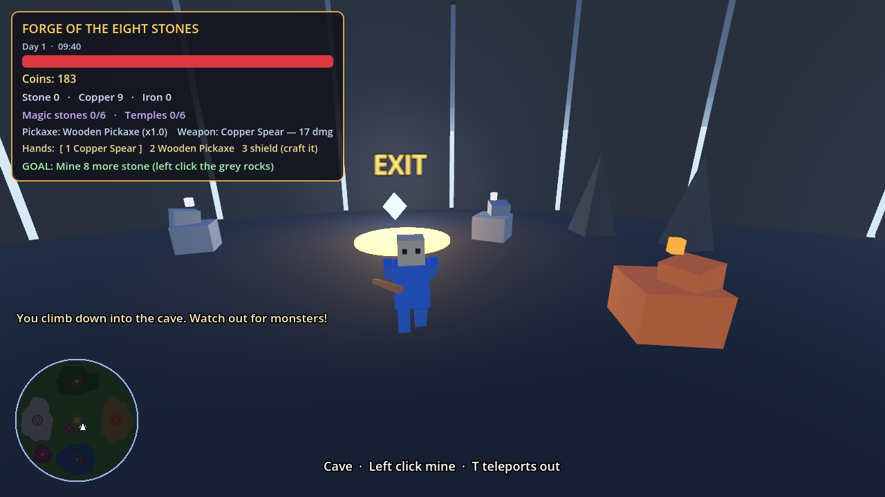

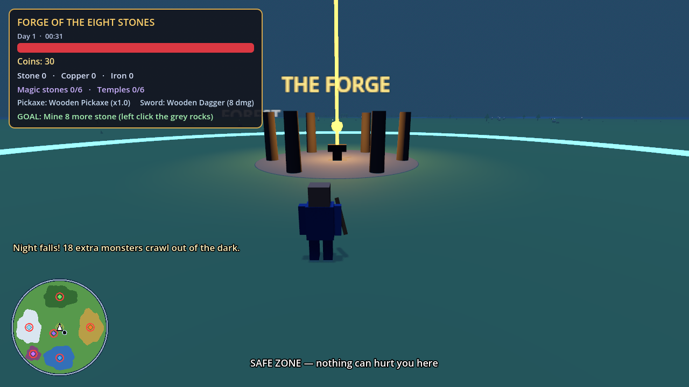

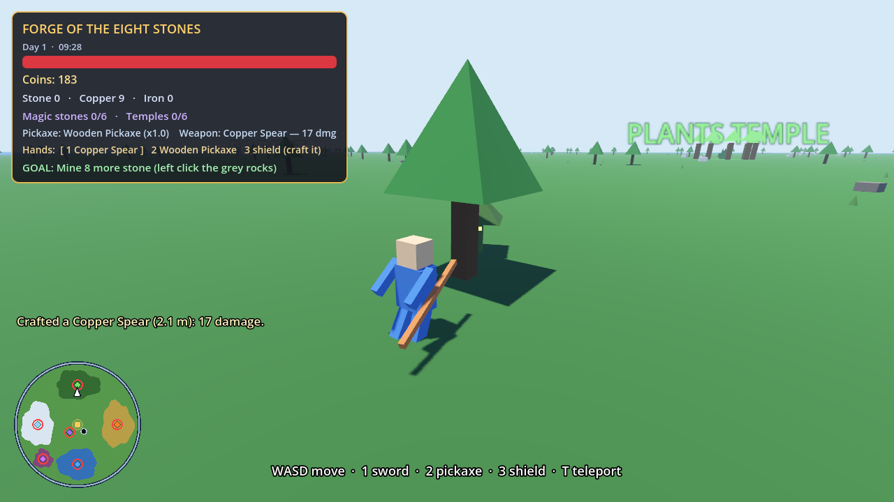

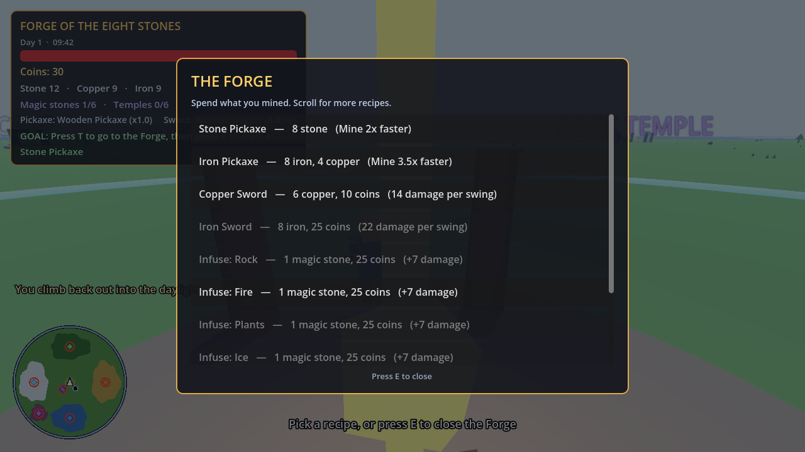

---

## The world

The island is **10 times bigger** than the first version: about **2.3 km across**,
so you run faster now (Shift = sprint) and the Forge teleport (**T**) is your
friend.

One round island made of **six land islands**, with a **lake between them** and
**stone bridges** from the Plains to each neighbour. Each biome has its own
look, its own temple shape, its own boss, and its own magic stone.

| Biome | Temple | Boss | Its special trick |
| --- | --- | --- | --- |
| Plains | Rock Temple (stone pillars) | Rock Golem | slow but very tough |
| Savanna | Fire Temple (dark obelisks) | Ember Golem | fast, sets you on fire |
| Forest | Plants Temple (giant trunks) | Vine Beast | heals itself while fighting |
| Snowy Forest | Ice Temple (crystal spires) | Frost Golem | very tough, slows you down |
| Lake | Water Temple (fountain) | Tide Serpent | very fast, knocks you away |
| Mushroom Island | Poison Temple (giant mushrooms) | Spore Beast | poisons you |

Deep underground there are **two more temples**: the **Thunder Temple** in the
Spiky Cave, home of the **Storm Golem**, and the **Uranium Temple** in the Acid
Cave, home of the **Uranium Golem**. Together they hold the seventh and eighth
magic stones.

**Bosses never leave their temple.** Every boss remembers its temple floor; if it
ever gets pushed too far, it stops chasing and walks back inside. The same is true
for normal monsters: each one is **leashed to its biome** and can never follow you
out of it.

Biome borders are not straight lines: each one is a wobbly shape built from
random waves, and the whole island is a circle (you cannot walk off the edge).

The characters are **blocky on purpose**: the player, the monsters and the bosses
are built only from **cubes and triangles** (see `scripts/shapes.gd`).
There are no smooth spheres or capsules anywhere on a character.

The **world follows the same rule**: ore rocks are cube clusters, trees have cube
trunks and pyramid leaves, temple pillars are square columns, and every gem is a
diamond made of 8 triangles. Only the ground, the sea and the water surfaces are
round, because they are the landscape itself.

### Six different monsters

Every biome has its own body shape, so you can tell what is chasing you:

| Biome | Monster shape |
| --- | --- |
| Plains | rock (rounded rocky capsule) |
| Savanna | spike (sharp cone) |
| Forest | plant (stem with a leafy crown) |
| Snowy Forest | crystal (faceted gem) |
| Lake | blob (round slime) |
| Mushroom Island | mushroom (stem with a cap) |

### Animation

The character is animated in code — there are no imported animation files:

- **walk / run** — legs and arms swing in opposite pairs, bigger and faster when
  you sprint, with a little bounce and a forward lean
- **jump / fall** — legs tuck up, arms lift
- **standing still** — gentle breathing

All of it is in `_animate()` in `scripts/player.gd`. The arms and legs hang on
pivot nodes (`LegPivotLeft`, `ArmPivotRight`, …) so a cube swings from the hip
instead of spinning around its middle.

### Your hands

You have two hands, and a key for each thing you can hold:

| Key | Hand | What left click does |
| --- | --- | --- |
| **1** | right | sword — attacks monsters |
| **2** | left | pickaxe — mines rocks fast |
| **3** | left | shield - hold left click to block 60% of a hit |
| **Bow** | right | a Forge weapon: left click shoots arrows from far away |

The active hand is raised, the other one hangs down, and the HUD shows
`Hands: 1 Sword  [ 2 Pickaxe ]  3 Shield` so you always know what is in hand.

- A sword only **chips** rock (0.5 damage), so press **2** to mine properly.
- A pickaxe hits monsters for **half** damage — press **1** to fight.
- The **shield** is a Forge recipe (12 stone + 20 coins).
- The **Hunter's Bow** is a Forge recipe (8 wood + 4 iron + 40 coins). Left
  click shoots an arrow; arrows hit the first monster in their path.
- You can also **draw your own bow** in the **Bow** tab of the drawing table.
  Magic stones can be added to a bow, too.

### Weapons are priced by size

Weapons are not one fixed recipe each: **the price comes from how tall the
weapon is**. Each material can be made into four shapes:

| Shape | Height | Copper cost | Coins | Damage (wood / copper / iron) | Reach | Swing |
| --- | --- | --- | --- | --- | --- | --- |
| Dagger | 0.45 m | 3 | 4 | 8 / 10 / 14 | 4.5 m | fast (0.22 s) |
| Sword | 1.00 m | 5 | 8 | 10 / 12 / 18 | 6.0 m | normal (0.32 s) |
| Katana | 1.30 m | 7 | 11 | 12 / 14 / 21 | 6.5 m | slower (0.38 s) |
| Spear | 2.10 m | 11 | 17 | 15 / 17 / 26 | 8.5 m | slowest (0.50 s) |

The rule in the code is literally the size:

```gdscript
metal = ceil(height * 5)
coins = ceil(height * 8)
```

You can make any weapon from **six materials**:

| Material | Where to find it | Base damage | Bonus on a drawn weapon |
| --- | --- | --- | --- |
| **Wood** | trees and log piles near the Forge and in the forests | 10 | ×0.8 |
| **Hardwood** | **ancient trees** on Mushroom Island | 14 | ×1.1 |
| **Copper** | orange rocks in the Savanna | 12 | ×1.0 |
| **Iron** | silver rocks in the Forest and Snowy Forest | 18 | ×1.5 |
| **Uranium** | green rocks in the Acid Cave | 24 | ×1.8 |
| **Sky Crystal** | **Sky Islands DLC** | 30 | ×2.0 |

Wood is common and soft (great for a first weapon), copper is a good middle
choice, iron is strong, and **uranium** is the strongest — with a green glow.
**You start with 6 wood**, so you can try a wooden drawing right away. Wooden
log piles also grow back, just like rocks.

A bigger weapon **looks** bigger in your hand (the model stretches), **reaches
further**, and **hits harder** — but swings slower. Magic stones now add their
+7 damage to whatever weapon you are holding.

### Draw your own weapon

At the top of the Forge menu there is a **drawing table**. You get a 9 × 14
grid: pick a paint material, then **click to paint, right click to erase**.

- One square = **9 cm**.
- **Every square keeps its material.** Paint the handle wood, the blade iron,
  or make it glow with **uranium** — the 3D weapon shows every colour.
- **Price is paid per material**: each material costs
  `ceil(squares of that material ÷ 2)`, plus `coins = ceil(total squares × 0.8)`.
- **Damage is a mix too**: every square adds its own material's strength
  (wood ×0.8, hardwood ×1.1, copper ×1, iron ×1.5, uranium ×1.8, sky crystal
  ×2.0). More iron, uranium or sky crystal = harder hits, while a wooden handle
  keeps the price low without weakening the blade much.
- **Size sets the power**: a tall, thick drawing does more damage and reaches
  further, but swings slower.
- A weapon that is **at least half iron** counts as an iron weapon, so it can
  take magic stones.
- **Magic stones can be added while you draw.** Every stone you own appears in
  the stone row under the paint buttons. Click one to add it to this weapon:
  **+7 damage** and **+25 coins** each. Stones you already infused show a ✓.
- When you forge it, the game builds a real 3D weapon out of your squares — one
  block per square, in its own colour — and puts it in your right hand. A magic
  stone makes the whole weapon glow, but the wood and iron colours stay.

Example: a 1.08 m tall, 0.27 m thick sword is 36 squares. Paint **27 iron**
squares for the blade and **9 wood** squares for the handle → **14 iron + 5 wood
+ 29 coins** → **27 damage**. All iron would be 31 damage; all wood would be 16.

### Magic stone powers

Every infused stone now gives your weapon a real battle trick:

| Stone | What your hit does |
| --- | --- |
| **Fire** | sets the monster burning for 2.5 seconds |
| **Ice** | slows the monster to half speed for 2.5 seconds |
| **Water** | knocks the monster away from you |
| **Poison** | poisons it for 4 seconds |
| **Rock** | stuns it for 1 second |
| **Plants** | heals you 2 health on every hit |
| **Thunder** | stuns and zaps up to two nearby monsters |
| **Uranium** | poisons and slows the monster with green radiation |

**You can mix stones.** If you have Fire and Ice, your hits both burn and slow.
The HUD shows `Mix: Fire + Ice` when two or more stones are active. You can add
several stones in the drawing table, or infuse them at the Forge.

### Wood from trees

Walk up to a **tree** and hold **left click** to chop it. Trees grow back after
about half a minute, and there are four types:

- **Oak** (Plains) — 4 wood.
- **Pine** (Forest) — 5 wood.
- **Icy** (Snowy Forest) — 4 wood, pale trunk.
- **Ancient** (Mushroom Island) — 2 **hardwood**, a stronger wood for drawing.

Log piles still give wood too.

### Swimming and diving

The lake and the sea are **water**. Walk in and the character floats forward and
paddles; **Shift** swims faster, and you cannot jump in water.

A glowing **DIVE** spot sits in the lake. Swim there and press **E** to enter the
**Sunken Grotto**: a blue underwater cave with a **breath bar**, glowing corals,
fish and a **sunken chest**. The gold pad (or running out of breath) sends you
back to the surface.

### Draw your own armour

The drawing table also has tabs for four armour pieces: **Helmet**,
**Chestplate**, **Pants** and **Boots**. Each piece keeps its own drawing, so
you can go back and change one without losing the others.

- Paint it with wood, hardwood, copper, iron, uranium or sky crystal, just like
  a weapon.
- The price uses the same rule: each material costs `ceil(squares ÷ 2)`, plus
  coins.
- **Defence is a percentage.** A piece protects from **2% to 12%**, based on how
  big and how strong the drawing is. Four good pieces can protect up to 48%.
- Your armour appears on your character: the helmet and chestplate are boxes,
  and the pants and boots move with your legs.

### Your bag

Press **!** (or **I**, or **E** while it is open) to open your bag. It has
**9 slots**, and **each slot holds up to 15 of one item**. Stone fills a slot,
then starts a second one. If all 9 slots are full, new items do not fit and you
get a message.

- Click nothing in the bag — it is a display for now, the Forge reads from it.
- **Coins are separate**: money is not an item, it lives in the HUD counter.

### Food and potions

Under your health bar there is a **food bar**. It goes down slowly, and faster
when you sprint. When it reaches zero you stop healing, so eat something!

| Key | What it does |
| --- | --- |
| **F** | Eat the best food you have: cooked meat (+70), jam (+55), meat (+50) or berries (+35) |
| **H** | Drink a healing potion: +40 health |
| **G** | Drink a speed potion: run faster for 10 seconds |

You start with **2 berries and 1 healing potion**. The trader sells more. The
HUD shows how many of each you are carrying.

**Meat is better food.** **Rabbits, boars, deer and foxes** are the wild animals
in the Plains, Savanna and Forest (the chickens, cow and sheep live in the farm
pen). Wild animals run away when you get close, so chase them and hit them
with your sword, bow, pickaxe or a **kick (V)**. A rabbit or fox drops **1 meat**,
a boar drops **2**, and a deer drops **3**. Meat fills **+50 food**, and **F eats
meat first** if you have some. Animals come back after about a minute.

### Campfire cooking

There is a **campfire** just outside the Forge ring. Walk up and press **E**:

| Cook | Result |
| --- | --- |
| 1 meat | **Cooked meat**: +70 food |
| 1 fish | **Cooked fish**: +65 food |
| 3 wheat | **Bread**: +80 food |
| 3 carrots | **Carrot soup**: +65 food and +10 health |
| 3 berries | **Berry jam**: +55 food and +10 health |

Warm food is the best food on the island. **If you kill an animal with a
Fire-stone weapon, it drops cooked meat right away.**

### Farming and fishing

- **Farm:** four soil plots sit near the Forge. Two grow **berries**, one grows
  **wheat** and one grows **carrots**. Plant with **E** (berry, wheat seed or
  carrot seed), wait 25 seconds, then harvest **3** of that crop.
- **Farm animals:** a pen near the Forge has **chickens**, a **cow** and a
  **sheep**. When a gold marker appears, press **E** to collect an **egg**,
  **milk** or **wool**.
- **Fishing:** a little pond is on the other side of the Forge. Press **E** to
  catch a **fish** (wait a moment between casts). Cook fish at the campfire.
- **Cooking:** wheat makes **bread** (+80 food), carrots make **carrot soup**
  (+65 food and +10 health).

### Hunting and kicking

Animals can be hunted with any weapon, or with a **kick (V)**. A kicked animal
drops normal meat. A weapon with the **Fire stone** cooks the meat as it drops.

### Secret vaults and underground features

Four hidden **treasure vaults** are tucked into the underground biomes: Normal,
Ice, Spiky and Acid — plus a **sunken chest** in the diving grotto. They hold
coins, potions, iron, hardwood or **uranium**, and can only be opened once.

The underground also has landmarks and **random cave formations**: the Crystal
Lake, the Lava Fissure, the Ancient Ruins and the Acid Geyser, with rocks and
crystals scattered all over.

### Weather

The sky changes between **Clear**, **Rain**, **Storm** and **Snow**. The HUD
shows the weather next to the clock. Rain and snow fall around you, and storms
make the sky darker. Weather disappears when you go underground.

### The wandering trader

A friendly trader walks around the island with a big backpack. Look for the
**orange dot** on the minimap, walk close and press **E**.

| Trade | Price |
| --- | --- |
| Buy 10 wood | 15 coins |
| Buy 5 copper | 35 coins |
| Buy 5 iron | 60 coins |
| Buy 3 berries | 12 coins |
| Buy 1 healing potion | 25 coins |
| Buy 1 speed potion | 30 coins |
| Sell 10 stone | +30 coins |

He stands still while you shop, then keeps walking. If your bag is full, he
cannot sell you the items until you make room.

### The forest wolf

A grey wolf lives in the **Forest**. Look for the **white dot** on the minimap
or the gold marker above its head. Walk close and press **E** to tame it.

After that it follows you, bites nearby monsters, and catches up if you get too
far away. It wears a red collar so you can tell it is yours. Your tamed wolf is
saved with your game.

**Train your wolf:**

- **E** next to it feeds it **1 meat** and raises its level (max 5). A
  higher-level wolf bites harder.
- **K** tells it to **stay** or **follow**.
- **L** sends it to attack the monster you are looking at (or the nearest one).

### Village quests

The Savanna village has **three villagers** — Mira the Baker, Tomas the Smith
and Lina the Scout. Walk close and press **E** to hear a tip.

There is also a wooden **quest board** (gold dot on the minimap). Press **E**
next to it to open the jobs:

| Quest | Bring | Reward |
| --- | --- | --- |
| Stock the village fire | 20 stone | 80 coins + 2 berries |
| Tools for the smith | 5 iron | 50 coins + 1 healing potion |
| Wire for the lamp | 3 copper | 30 coins + 1 speed potion |
| Strange green metal | 3 uranium | 150 coins + 2 healing potions |
| Meat for the feast | 10 meat | 100 coins + 3 berries |
| Wood for the roof | 10 wood | 60 coins + 1 healing potion |
| Ancient timber | 5 hardwood | 200 coins + 2 speed potions |

Uranium comes from the **Acid Cave** underground. Each quest can be done once.
The board marks it **✓ DONE** afterwards.

### Pause menu and sounds

Press **Escape** to pause. The pause menu has **Resume**, **Save Game**,
**Log Out**, a controls list and **New Game**. New Game asks you to click twice
because it erases your save.

The game now has **sound effects and music**: mining, hits, the bow, eating,
coins, quests and boss roars, with a gentle looping tune.

### Saving your game

At the Forge menu there are two buttons:

- **SAVE GAME** — saves your bag, coins, weapons (including the bow), armour,
  magic stones, village quests, your wolf and its training, your food bar,
  weather, farm and animals, secret vaults, the final boss, the Sky Islands
  DLC and the time of day.
- **LOG OUT (saves first)** — saves and closes the game. There are no accounts;
  "log out" simply means "save and leave".

The game also saves when you close its window. Next time you launch it, your
save loads automatically. The save file is
`user://forge_save.json`, which on Windows is inside
`%APPDATA%\Godot\app_userdata\Forge of the Eight Stones\`.

### Chests

There are **two wooden chests** at the Forge. Walk up and press **E** to open one:
your bag is on the right, the chest on the left. **Click an item** to move that
whole stack from one side to the other. Chests keep their items forever, so you
can store ore at home and travel light.

### Day and night

One full day lasts **3 minutes**. The sun crosses the sky, sunsets go orange, and
then it gets dark (the temples and the Forge glow at night).

- **At night, 18 extra monsters appear**, and they are stronger (60% more health,
  twice the coins) and a bit faster.
- When the sun comes up, those night monsters vanish.
- The clock in the top-left shows `Day 2 · 21:40`.

### Safe zone

The Forge is a **safe zone**: a glowing cyan ring marks a 30 m circle where
nothing can hurt you. Monsters are pushed out of it and cannot step inside, so
you can always run home to heal. The HUD says `SAFE ZONE — nothing can hurt you here`.

### The underground

There is a stone doorway with a dark hole in the plains, to the south-east of the
Forge (about 180 m away — follow the grey dot on the minimap). Stand next to it
and press **E** to climb down.

The underground is **as wide as the whole surface island**. There are **no
teleport pads between the caves** — you walk from one to another. A gold pad at
the entrance takes you back up (or press **T**).

The underground is a round pizza of **four connected cave biomes**:

| Cave | Share | What is inside |
| --- | --- | --- |
| **Normal Cave** | 40% | the entrance, stone/copper/iron, normal cave monsters |
| **Spiky Cave** | 30% | spiky rocks, spike monsters, and the **Thunder Temple** |
| **Ice Cave** | 15% | blue crystals and crystal monsters |
| **Acid Cave** (the poison cave) | 15% | green acid pools, poisonous monsters, **uranium** and the **Uranium Temple** |

- **Thunder Temple:** walk into the Spiky Cave. The **Storm Golem** waits in an
  open arena; its **Thunder stone** gives your weapon a lightning chain.
- **Acid Cave:** the green pools hurt if you stand in them, and the mushroom
  monsters poison you. **Uranium ore** grows only here. Bring 3 uranium to the
  village quest board for a big reward.
- **Uranium Temple:** deep in the Acid Cave waits the **Uranium Golem**. Beat it
  for the eighth magic stone, which poisons and slows monsters.
- **Ice Cave:** glowing blue crystals and tough crystal monsters.
- The **borders between the four caves are random and wavy**, not straight lines.
  Their shares are still roughly 40 / 30 / 15 / 15, and every cave is filled
  with random rocks, **little rock mountains**, hanging **stalactites** and
  glowing crystal clusters.
- The **floor is bumpy**, with rolling hills, dips, extra rounded bumps and real
  collision. The entrance, temples and vaults sit on flat patches, so nothing
  floats.
- The minimap switches to the **underground map** and shows the wavy coloured
  caves, the exit pad and both underground bosses.

### The final trial

When **all 8 stones are infused**, the **FINAL TRIAL** portal at the Forge starts
to glow. Press **E** to step through and fight the **Eight-Stone Guardian**.

Beat it and you get the **ending screen**. You can keep exploring or start a New
Game. The ending is saved, so the Guardian stays defeated.

### DLC: Sky Islands

After the ending, a **Sky Portal** appears at the Forge. Press **E** to fly to
the **Sky Islands**: four floating islands joined by sky bridges, full of
**Sky Crystal** ore, clouds and a **Sky Temple**.

The **Sky Dragon** waits in the temple. Beat it for coins and **6 Sky Crystals**,
and a DLC ending screen. Sky Crystal is the strongest drawing material (30 base
damage, ×2.0 on a drawn weapon). A return pad takes you home, and falling off an
island drops you safely back on the main one.

### Minimap

The round map in the bottom-left corner shows the island, the six surface biomes,
the Forge (gold dot), every temple (coloured diamond), living bosses (red ring),
the wandering trader (orange dot), the quest board (gold dot), the wild wolf
(white dot), and **you** as a white arrow pointing where you are facing.


---

## Play it right now

**Easiest way:** double-click **`Play.bat`** in this folder. That's it — the
Godot engine is already inside `tools\`, so nothing needs to be installed.

| File | What it does |
| --- | --- |
| `Play.bat` | Starts the game |
| `Edit.bat` | Opens the Godot editor (press **F5** there to play) |
| `Test.bat` | Runs the automated test and shows the result |

If you prefer a normal install, get **Godot 4.7** from
<https://godotengine.org/download>, open it, click **Import**, pick
`project.godot`, then press **F5**.

The game starts on the Plains, a few steps from the Forge.

---

## Controls

| Key | What it does |
| --- | --- |
| **W A S D** | Walk |
| **Mouse** | Look around |
| **Shift** | Run (or swim faster) |
| **Space** | Jump |
| **Left click** | Mine, hit, or shoot an arrow with the bow |
| **E** | Use the Forge, chest, cave, campfire, trader, villager, quest board, dive spot or final portal; feed your wolf |
| **!** (or **I**) | Open your bag |
| **1 / 2 / 3** | Hold the sword (or bow) / pickaxe / shield |
| **F** | Eat the best food you have |
| **H** | Drink a healing potion |
| **G** | Drink a speed potion |
| **K** | Tell your wolf to stay / follow |
| **L** | Send your wolf to attack |
| **V** | Kick an animal |
| **T** | Teleport to the Forge (free, any time, even from the cave) |
| **Escape** | Pause the game (and free the mouse) |

---

## Your goal in Chapter 1
A green **GOAL** line in the top-left always tells you the next step:

1. Mine **8 stone** (grey rocks with a white sparkle over them).
2. Press **T**, then **E** at the Forge and craft a **Stone Pickaxe**.
3. Mine **copper** (orange, in the Savanna) and **iron** (silver, in the Forest).
4. Craft an **iron weapon** — a sword is a good start.
5. Find a temple and beat its boss. The boss drops its **magic stone**.
6. Infuse the stone into your sword at the Forge — or add it while drawing your
   weapon: **+7 damage per stone**, and the blade glows in that element's colour.
   Every stone also adds a battle power (burn, slow, push, poison, stun, heal or
   lightning).
7. Beat all **6 surface bosses**, then walk into the **Spiky Cave** for the
   **Storm Golem** and the **Acid Cave** for the **Uranium Golem**. Infuse all
   **8 stones**.
8. Walk to the **FINAL TRIAL** portal at the Forge and beat the **Eight-Stone
   Guardian** to finish the main story.
9. Step into the **Sky Portal** and beat the **Sky Dragon** to finish the **Sky
   Islands DLC**.

You earn coins by killing monsters, selling spare stone at the Forge, and doing
village quests. The HUD shows your progress: `Magic stones 2/8 · Temples 2/8`.

---

## Making your own 3D models

You can replace any shape in the game with your own model — a character, a sword,
a tree, a boss. The full guide (best tools, file format, scale rules, how to
import) is in **[docs/3D_MODELS.md](docs/3D_MODELS.md)**.

The short version: build it in **Blender**, **Blockbench** or **MagicaVoxel**,
export as **`.glb`**, drop it into `assets/models/`, and Godot imports it
automatically.

---

## Where to change the game
Almost everything you would want to tweak lives in one of these three files:

| File | What is in it |
| --- | --- |
| `scripts/world_data.gd` | The six surface biomes plus the Thunder and Uranium temples, bosses and stones |
| `scripts/game.gd` | Balance numbers, recipes, world building, goals |
| `scripts/ore_node.gd` | How tough each rock or log pile is and what it drops |
| `scripts/enemy.gd` / `scripts/boss.gd` | Monster speed, health, damage, boss abilities |

Examples:

- Want to jump higher? Open `scripts/player.gd` and change `jump_force`.
- Want cheaper recipes? Open `scripts/game.gd`, find `_build_recipes()` and edit `"cost"`.
- Want a boss to hit harder? Change `"damage"` in `scripts/world_data.gd`.
- Want the island bigger? Change `WORLD_RADIUS` in `scripts/world_data.gd`.
- Want ores to respawn faster? Change `"respawn"` in `scripts/ore_node.gd`.

After any change, press **F5** to play again.

---

## Project map

```
project.godot          Godot settings (do not edit by hand unless you know why)
Play.bat               double-click to play
Edit.bat               double-click to open the Godot editor
Test.bat               double-click to run the automated test
tools/                 the Godot engine itself (can be deleted, see tools/README.txt)
scenes/
  main.tscn            the world: sky, sun, and the game script
  player.tscn          the player capsule, camera and held weapon
  ore_node.tscn        a mineable rock (mesh + collision + sparkle)
  wood_node.tscn       a mineable pile of logs (drops wood)
  enemy.tscn           a Rockling
  boss.tscn            the Rock Golem
scripts/
  world_data.gd        the surface biomes, underground temples, bosses and stones
  game.gd              builds the world, stores inventory, runs the Forge
  player.gd            movement, camera, mining and attacking
  ore_node.gd          rock health, drops and respawn
  enemy.gd             wandering, chasing, damage, coin drops
  boss.gd              boss behaviour, special abilities and the temple leash
  hud.gd               on-screen stats, goal, Forge menu, drawing table, shop
  minimap.gd           the round minimap drawn in the corner
  spinner.gd           spins the Forge crystal
  trader.gd            the wandering trader and his walk
  wolf.gd              the forest wolf, taming, training, following and biting
  animal.gd            wild rabbits, boars, deer and foxes
  farm_animal.gd       chickens, cows and sheep in the farm pen
  tree.gd              choppable trees that give wood and grow back
  arrow.gd             the bow's flying arrow
  villager.gd          the three villagers in the Savanna
  weapon_canvas.gd     the square grid used to draw weapons and armour
tests/
  smoke_test.tscn      automated test of the core loop
  screenshot.tscn      takes screenshots of the game
```

---

## Tests

Run the automated test (no window opens):

```
godot --headless --path . res://tests/smoke_test.tscn
```

It checks the whole loop: the round island, the six wobbly biome shapes, walking,
jumping, the character facing the right way, the minimap, the six monster shapes,
mining, crafting, infusing, selling, damage, coin drops, the boss reward, bosses
and monsters staying inside their area, day/night, extra night monsters,
teleporting, drawn armour, the wandering trader and his shop, the forest wolf
and its training,
hunting animals for meat, magic stone powers and mixing, the huge connected
underground and its four wavy cave biomes, bumpy cave floor, random formations, uranium gear,
both underground bosses, the final Guardian and ending, village life and quests,
weather, wolf training, campfire cooking, farming, fishing, secret vaults,
diving, kicking and Fire-cooked meat, swimming, chopping trees, wild deer and
foxes, farm animals and crops, bread and soup, hardwood, drawing bows, the
Sky Islands DLC and Sky Dragon, the pause menu, sound and music, and saving and
loading. It prints `ALL PASSED` or the list of failures.

---

## What is not built yet

Chapter 1 is a real game, but the design document is much bigger. Still missing:

- more rooms and secrets after the DLC,
- **more DLC** after the Sky Islands,
- **village merchant NPCs** (armour, disguises, more food),
- **more villager stories and quests**,
- **more crops and fishing spots**,
- **shuriken and other ranged weapons**,
- **disguises and infiltration**.

A good next step is to pick **one** of those and build it the same way:
small working piece first, then make it bigger.
